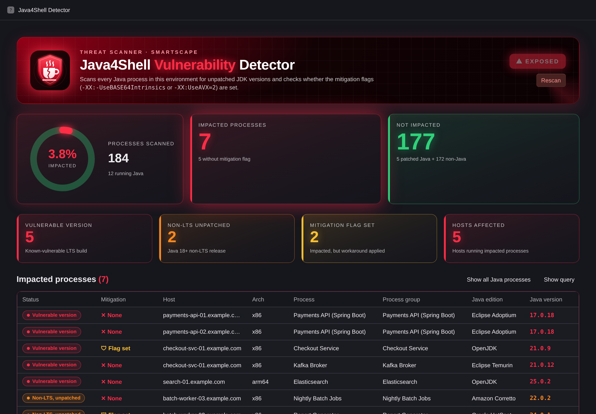
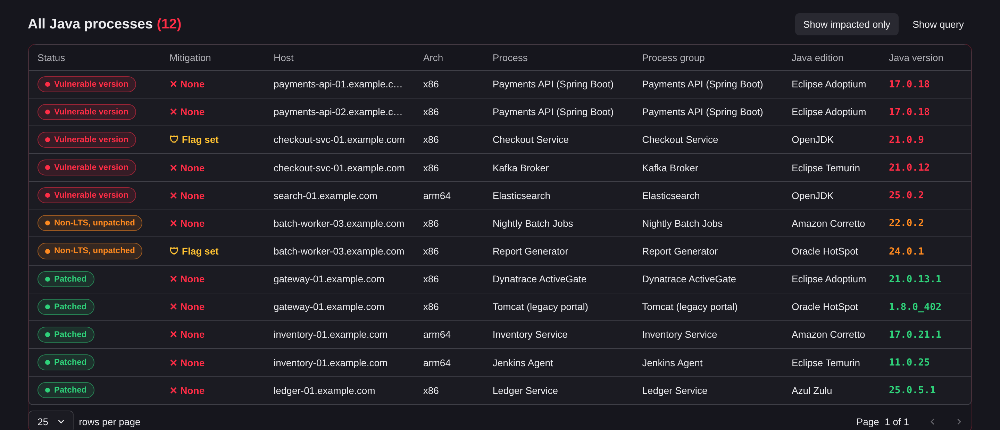
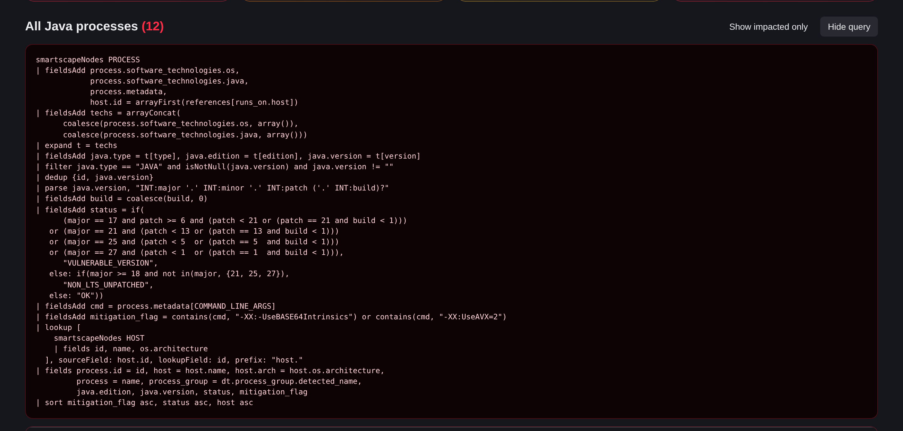

# Java4Shell Detector

A Dynatrace app that scans every Java process in your environment for JDK versions affected by
**Java4Shell**. For each affected process, it checks whether a mitigation flag is set on its command line.

It reads process and host data from **Smartscape** in Grail. It needs no extra agents or extensions,
and no data leaves your tenant.



> Screenshots use sample data (`*.example.com` hosts) and the dark theme.

## What it shows

- **Processes scanned**: every process in Smartscape, and how many of them run Java.
- **Impacted processes**: Java processes on a vulnerable or unpatched JDK, and how many of those have no mitigation flag.
- **Not impacted**: patched Java processes plus all non-Java processes.
- **Breakdown**: vulnerable LTS builds, unpatched non-LTS releases, processes with a mitigation flag, and affected hosts.
- **Process table**: host, architecture, process, process group, Java edition and version. It is sortable and
  paginated. It shows impacted processes by default; **Show all Java processes** lists every Java process.
- **Rescan**: queries Grail again. **Show query** displays the DQL the app runs.



### How a process is classified

| Status | JDK versions |
| --- | --- |
| **Vulnerable version** | 17.0.6 – 17.0.21, 21 before 21.0.13.1, 25 before 25.0.5.1, 27 before 27.0.1.1 |
| **Non-LTS, unpatched** | Any Java 18+ release that isn't 21, 25 or 27 (18, 19, 20, 22, 23, 24, 26, …) |
| **Patched** | Everything else, including 17.0.21.1+, 21.0.13.1+, 25.0.5.1+, 27.0.1.1+, and Java 16 or older |

A process counts as **mitigated** if its command line contains `-XX:-UseBASE64Intrinsics` or `-XX:UseAVX=2`.
If a process reports more than one Java version, it gets the worst status among them.

The full query lives in [`ui/app/queries.ts`](ui/app/queries.ts):



## Deploy it to your own Dynatrace tenant

### Prerequisites

- A **Dynatrace SaaS** environment on the latest platform (AppEngine and Grail with Smartscape),
  e.g. `https://abc12345.apps.dynatrace.com`.
- **Node.js 24** (20.19+ works, but dt-app warns) and npm.
- Permission to install apps in that environment.

### 1. Download the code

```bash
git clone https://github.com/yahrghrr/dynatrace-app.git
```

```bash
cd dynatrace-app
```

```bash
npm ci
```

Or use **Code → Download ZIP** on GitHub, unzip it, and run `npm ci` in the folder.

### 2. Create credentials for deploying

Pick **one** of these:

- **OAuth client** (recommended for CI): in Dynatrace, go to **Account Management → Identity & access
  management → OAuth clients → Create client**. Grant the scopes `app-engine:apps:install` and
  `app-engine:apps:run`, then copy the client ID and secret.
- **Platform token**: create a platform token with the same two scopes.

### 3. Set the environment variables

Copy the template and fill it in. `.env` is gitignored, so never commit it.

```bash
cp .env.example .env
```

```dotenv
DT_APP_ENVIRONMENT_URL=https://abc12345.apps.dynatrace.com
DT_APP_OAUTH_CLIENT_ID=dt0s02.XXXXXXXX
DT_APP_OAUTH_CLIENT_SECRET=dt0s02.XXXXXXXX.YYYYYYYY
# or instead of the two above:
# DT_APP_PLATFORM_TOKEN=dt0s16.XXXXXXXX.YYYYYYYY
```

Load it into your shell (macOS/Linux):

```bash
set -a; source .env; set +a
```

On Windows PowerShell, set each variable with `$env:DT_APP_ENVIRONMENT_URL = "https://…"` and so on.

### 4. Deploy

```bash
npm run deploy:prod
```

When it finishes, it prints the app URL, e.g. `https://abc12345.apps.dynatrace.com/ui/apps/my.java4shell.detector`.
The app also appears in the Dynatrace launcher as **Java4Shell Detector**.

### 5. Give users access

The app runs its queries as the signed-in user. Each user needs the **`storage:smartscape:read`**
permission, granted through a policy or group in Identity & access management. Without it, the app shows
"Query failed".

### Updating or redeploying

Dynatrace won't reinstall a version number that is already installed with different contents.
Before each redeploy, increase `version` in [`app.config.ts`](app.config.ts) (e.g. `0.0.1` → `0.0.2`).

## Production and debug variants

One `app.config.ts` produces two separate apps, chosen with `--payload`. You can install them side by side:

| Variant | App ID | Deploy | Uninstall |
| --- | --- | --- | --- |
| Production | `my.java4shell.detector` | `npm run deploy:prod` | `npm run uninstall:prod` |
| Debug (unminified, readable code) | `my.java4shell.detector.debug` | `npm run deploy:debug` | `npm run uninstall:debug` |

- `npm run deploy:all` deploys debug first, then production.
- `npm run package:prod` and `npm run package:debug` build a deployable `.zip` in `out/` without installing it.
  Use it to hand the app to someone with install rights, or to keep a release artifact.

To change the app ID or name, for example to avoid clashing with another copy in the same tenant, edit
`BASE_APP_ID` / `BASE_APP_NAME` in `app.config.ts`. Custom app IDs must start with `my.`.

## Local development

```bash
npm run start
```

This starts a dev server against `DT_APP_ENVIRONMENT_URL`. It opens a browser, asks you to sign in, and
reloads on changes. Before pushing, run:

```bash
npm run lint
```

```bash
npm run build
```

### Project layout

```text
app.config.ts             App ID, name, version, scopes; prod/debug variant switch
ui/app/queries.ts         DQL detection query and result types
ui/app/pages/Detector.tsx Dashboard page (tiles, threat ring, process table)
ui/app/components/        App header
ui/assets/                App icon
docs/screenshots/         README screenshots (sample data)
```

## Learn more

- [Dynatrace Developer](https://developer.dynatrace.com/): App Toolkit, Strato design system and SDKs
- [DQL reference](https://docs.dynatrace.com/docs/platform/grail/dynatrace-query-language)
